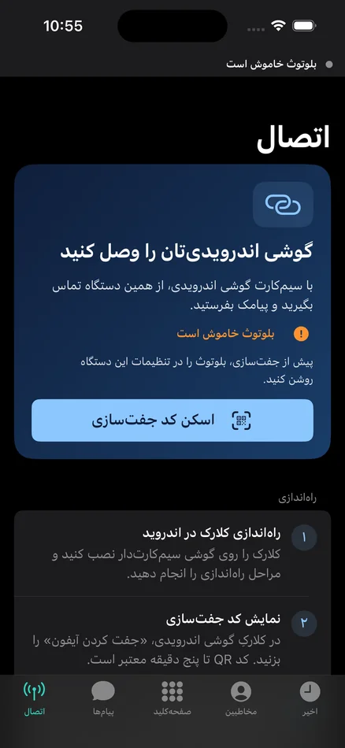
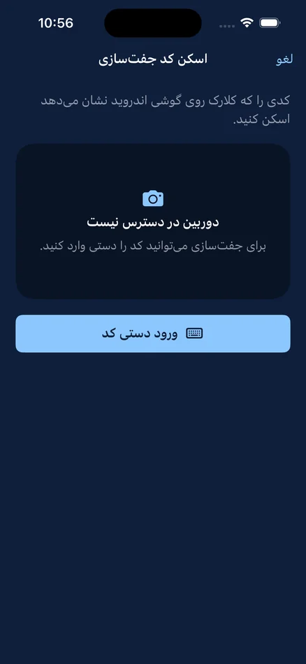
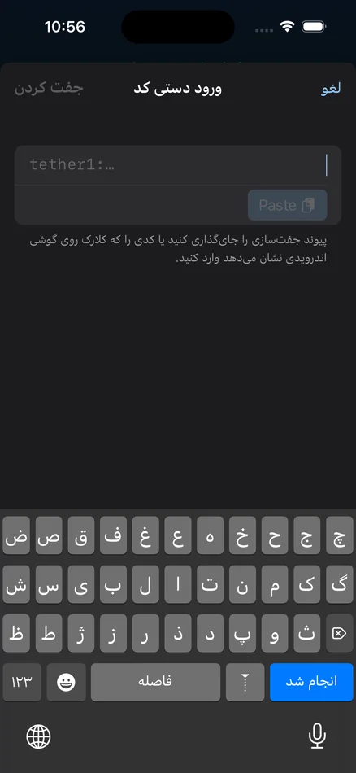

<h1 align="center">کلارک · Clark</h1>

<p align="center"><strong>تماس‌ها و پیامک‌های سیم‌کارت اندروید، روی آیفون یا گوشی دوم</strong></p>

<p align="center">
  <a href="https://github.com/ashkan0033/tether/releases/tag/v1.1.1-rc.1"></a>
  <a href="https://github.com/ashkan0033/tether/actions/runs/45600836462"></a>
  
  
  <a href="LICENSE"></a>
</p>

<p align="center">
  <a href="#دانلود">دانلود</a> ·
  <a href="#پیش‌نمایش-آیفون">پیش‌نمایش</a> ·
  <a href="#شروع-کار">شروع کار</a> ·
  <a href="#ساخت-از-سورس">ساخت از سورس</a> ·
  <a href="#english">English</a>
</p>

<div dir="rtl" lang="fa">

گوشی اندرویدی سیم‌کارت‌دار کنار دستتان می‌ماند و از آیفون، آیپد یا یک اندروید دیگر تماس‌ها، پیامک‌ها، مخاطبان و سابقهٔ تماسش را مدیریت می‌کنید. دو دستگاه با اسکن QR جفت می‌شوند و از طریق بلوتوث با رمزنگاری سرتاسری به هم وصل می‌شوند. راه‌اندازی به حساب کلارک یا سرور واسط نیاز ندارد.

</div>

## پیش‌نمایش آیفون

<table>
  <tr>
    <td align="center"><br><strong>اتصال به میزبان</strong></td>
    <td align="center"><br><strong>اسکن کد QR</strong></td>
    <td align="center"><br><strong>ورود دستی کد</strong></td>
  </tr>
</table>

نمونه‌هایی از فرایند اتصال در [شبیه‌ساز آیفون](https://github.com/ashkan0033/tether/actions/runs/45601031152). تصویر وسط حالت «دوربین در دسترس نیست» را نشان می‌دهد و گزینهٔ ورود دستی در همان صفحه در دسترس است.

## امکانات

| بخش | کاربرد |
| --- | --- |
| تماس | شماره‌گیری، پاسخ و رد تماس، بی‌صدا کردن و نمایش سابقه. انتقال صدای دوطرفه به مدل و نسخهٔ اندروید میزبان بستگی دارد |
| پیامک | نمایش گفتگوها، ارسال و دریافت، اعلان پیام جدید و کپی کدهای یک‌بارمصرف |
| مخاطبان | جست‌وجو، مشاهده و ویرایش مخاطبان، علاقه‌مندی‌ها و دسترسی به سابقهٔ تماس |
| وضعیت اتصال | نمایش باتری میزبان، وضعیت سیم‌کارت‌ها، وضعیت بلوتوث و گزارش اتصال |
| ابزارهای میزبان | پیدا کردن گوشی و کنترل بعضی تنظیمات شبکه و سیم‌کارت، در صورت پشتیبانی دستگاه و راه‌اندازی ماژول کمکی |
| رابط فارسی | صفحه‌های راست‌چین، راهنمای اتصال مرحله‌به‌مرحله و امکان اسکن QR یا ورود دستی کد در آیفون |

برای انتقال صدا و ابزارهای شبکه، [سازگاری مدل‌ها](docs/devices/android-versions.md) و [راهنمای راه‌اندازی](docs/SETUP.md) را ببینید.

## دانلود

نسخهٔ فعلی برای آزمایش است. دو APK اندروید با کلید آزمایشی امضا شده‌اند. فایل IPA آیفون برای نصب به امضای جداگانه نیاز دارد.

| فایل | کجا استفاده می‌شود؟ | حداقل نسخه |
| --- | --- | --- |
| [کلارک میزبان · APK](https://github.com/ashkan0033/tether/releases/download/v1.1.1-rc.1/Clark-Android-Host-1.1.1-rc.1-debug-signed.apk) | گوشی اندرویدی سیم‌کارت‌دار با پشتیبانی از تبلیغ BLE | Android 8 |
| [کلارک آیفون · IPA](https://github.com/ashkan0033/tether/releases/download/v1.1.1-rc.1/Clark-iOS-1.1.1-rc.1-unsigned.ipa) | آیفون یا آیپد | iOS و iPadOS 16 |
| [کلارک همراه · APK](https://github.com/ashkan0033/tether/releases/download/v1.1.1-rc.1/Clark-Android-Client-1.1.1-rc.1-debug-signed.apk) | گوشی دوم، اگر اندرویدی باشد | Android 10 |

[صفحهٔ انتشار و فایل SHA256SUMS](https://github.com/ashkan0033/tether/releases/tag/v1.1.1-rc.1) · [راهنمای نصب و امضای آیفون](docs/INSTALL.md)

## شروع کار

1. **گوشی میزبان را آماده کنید.** APK میزبان را روی اندروید سیم‌کارت‌دار نصب کنید، مجوزهای داخل اپ را بررسی کنید و کلارک را به‌عنوان برنامهٔ پیش‌فرض تلفن انتخاب کنید.
2. **کد جفت‌سازی را نمایش دهید.** بلوتوث هر دو دستگاه را روشن کنید، گوشی‌ها را نزدیک هم قرار دهید و در اپ میزبان روی «جفت کردن آیفون» بزنید. کد QR پنج دقیقه اعتبار دارد.
3. **دستگاه دوم را وصل کنید.** در آیفون از زبانهٔ «اتصال» گزینهٔ «اسکن کد جفت‌سازی» را بزنید. در اندروید دوم از اسکنر کلارک همراه استفاده کنید. کلارک آیفون کد یا پیوند جفت‌سازی را به‌صورت دستی هم می‌پذیرد.

برای راه‌اندازی قابلیت‌های تماس صوتی و رفع مشکل همگام‌سازی، [راهنمای کامل اتصال](docs/SETUP.md) و [رفع اشکال](docs/TROUBLESHOOTING.md) را ببینید.

## وضعیت تست

- **اندروید:** بیلد میزبان و کلارک همراه موفق بوده و ۳۳۱ تست خودکار در بررسی نسخهٔ آزمایشی پاس شده‌اند.
- **آیفون:** بیلد Xcode و تست‌های خودکار اپ در شبیه‌ساز پاس شده‌اند. فایل منتشرشده بدون امضاست.
- **گوشی واقعی:** جفت‌سازی بلوتوث، پیامک، تماس، صدای دوطرفه و اتصال دوباره هنوز باید روی دو دستگاه واقعی تأیید شوند.

[نتایج CI](https://github.com/ashkan0033/tether/actions/runs/45600836462) · [بیلد انتشار](https://github.com/ashkan0033/tether/actions/runs/45755886058) · [گزارش مشکل](https://github.com/ashkan0033/tether/issues)

## ساخت از سورس

```bash
git clone https://github.com/ashkan0033/tether.git clark
cd clark
```

### اندروید

به JDK 17، پلتفرم Android SDK 36 و Android SDK Build-Tools نیاز دارید. Android Studio مسیر SDK را در `android/local.properties` تنظیم می‌کند. بیلد با Gradle Wrapper پروژه انجام می‌شود.

```bash
cd android
./gradlew :app:assembleDebug :client:assembleDebug
```

در PowerShell ویندوز از `.\gradlew.bat` استفاده کنید. APKها در `android/app/build/outputs/apk/debug/` و `android/client/build/outputs/apk/debug/` قرار می‌گیرند.

### آیفون و آیپد

برای بیلد به macOS، Xcode و XcodeGen نیاز دارید. نام داخلی پروژه و Scheme هنوز `Tether` است.

```bash
cd ios
xcodegen generate
xcodebuild -project Tether.xcodeproj -scheme Tether \
  -destination 'generic/platform=iOS' -skipMacroValidation CODE_SIGNING_ALLOWED=NO build
```

برای اجرا در شبیه‌ساز یا نصب روی آیفون، [راهنمای بیلد](docs/BUILD.md) را ببینید. در نسخهٔ Debug، آرگومان‌های `-TetherDemoPair` و `-TetherDemoPairManual` مسیر اسکن و ورود دستی را برای پیش‌نمایش باز می‌کنند.

## ساختار پروژه و مستندات

| مسیر | شرح |
| --- | --- |
| [`android/app`](android/app) و [`android/client`](android/client) | میزبان سیم‌کارت و اپ گوشی دوم اندرویدی |
| [`ios/Tether`](ios/Tether) | اپ آیفون و آیپد |
| [`android/core`](android/core) و [`ios/TetherCore`](ios/TetherCore) | هستهٔ Kotlin و Swift برای ارتباط و همگام‌سازی |
| [`protocol`](protocol/PROTOCOL.md) | مشخصات پروتکل و داده‌های آزمون مشترک |

[معماری](docs/ARCHITECTURE.md) · [راهنمای استفاده](docs/USAGE.md) · [سؤالات رایج](docs/FAQ.md) · [آزمون‌ها](docs/TESTING.md) · [امنیت و حریم خصوصی](SECURITY.md) · [تاریخچهٔ تغییرات](CHANGELOG.md)

## English

**Clark brings calls, SMS, contacts, and call history from a SIM-equipped Android phone to an iPhone, iPad, or another Android device.** Pair using a QR code and keep the devices within Bluetooth range. The link is end-to-end encrypted and requires no Clark account or relay server.

The [GitHub prerelease](https://github.com/ashkan0033/tether/releases/tag/v1.1.1-rc.1) includes Android test APKs and an unsigned iPhone IPA. Android builds and iOS simulator tests have passed. Bluetooth pairing, SMS, and two-way call audio still need physical-device validation.

[Setup](docs/SETUP.md) · [Build guide](docs/BUILD.md) · [Compatibility](docs/devices/android-versions.md)

## مجوز

کلارک بر پایهٔ [Tether، پروژهٔ amirwmr و مشارکت‌کنندگان](https://github.com/amirwmr/tether) توسعه داده می‌شود و تحت [مجوز MIT](LICENSE) است.
